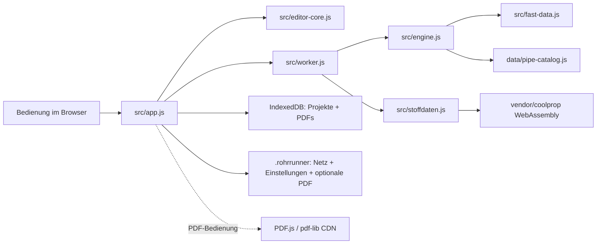

# Architektur

RohrRunner ist eine statische Browseranwendung ohne Backend, Bundler oder npm-Laufzeitpakete. HTML bindet klassische JavaScript-Dateien in definierter Reihenfolge ein; die Module stellen ihre APIs über Browser-Globals bereit.

## Laufzeitfluss

Die Berechnung läuft über `Worker`. Unter `file://` lädt die App das generierte Bundle als Script und startet es als Blob-Worker, ohne zusätzlichen Server. Unter HTTP(S) wird `src/worker.js` direkt gestartet. Wenn der Browser den Worker blockiert, fällt die App auf den Hauptthread zurück. PDF.js und pdf-lib sind separate Client-Bibliotheken; sie werden für PDF-Import, Darstellung und Plan-PDF-Ausgabe gebraucht.

## Komponenten

| Datei | Verantwortung |
| --- | --- |
| `index.html` | UI-Struktur, Standardwerte, Script-Reihenfolge und CDN-Einbindung der PDF-Bibliotheken |
| `src/app.js` | UI-Ereignisse, Zeichnen/Ansicht, lokale Speicherung, Import/Export, Worker-Kommunikation und Ergebnisdarstellung |
| `src/zip.js` | Erstellt lokal ZIP-Archive für Projektpakete ohne zusätzliche Laufzeitabhängigkeit |
| `src/editor-core.js` | Unabhängige Geometrieoperationen wie rechtwinklige Pfade, Segmentkreuzungen, Verschieben und Löschen von Knoten/Leitungen |
| `src/engine.js` | Baumvalidierung, Massenströme, hydraulische Segmentrechnung, Szenarien und automatische/manuelle Rohrwahl |
| `src/stoffdaten.js` | CoolProp-Lader, Stoffwertzugriff, Phasenprüfung, Einheiten/Sättigungswerte und Viskositätskorrekturen |
| `src/fast-data.js` | Begrenzte, pro Einstellung vorberechnete Interpolationspfade; außerhalb des gültigen Bereichs Rückfall auf Stoffdatenfunktionen |
| `src/worker.js` | Worker-Nachrichtenformat und Aufruf des Solvers |
| `src/worker-bundle.js` | Generiertes, vollständig eingebettetes Bundle für Blob-Worker unter `file://` |
| `scripts/build-worker-bundle.mjs` | Erzeugt das Bundle aus Worker, CoolProp, Stoffdaten und Solver |
| `RohrRunner.bat` | Optionaler Windows-Shortcut zum Öffnen der HTML-Datei |
| `src/style.css` | Layout, Zeichenfläche, Inspector und responsive Anpassungen |
| `data/pipe-catalog.json` | Rohrserien, Geometrie, Druckangaben, Bedingungen und Quellen |
| `data/pipe-catalog.js` | Browser-Global `RohrKatalog` für direkt geöffnetes HTML und Worker |
| `data/fluid-references.json` | Quellen und dokumentierte Stoffwert-Referenzdaten |
| `vendor/coolprop/` | Lokal mitgelieferte CoolProp-WASM-Laufzeit und zugehörige Lizenz |
| `scripts/serve.mjs` | Kleiner, nur an `127.0.0.1` gebundener HTTP-Server für lokale Entwicklung |

## Daten und Speicherung

Das Projektobjekt enthält Versionsfeld, Projekt-ID und -Name, Knoten, Leitungen, Maßstab, Einstellungen und optional das letzte Ergebnis. Knoten haben einen Typ (`start`, `junction`, `endpoint`); Leitungen verbinden zwei Knoten und enthalten einen rechtwinkligen Punktpfad. Zusatzlänge, `Σζ`, manuelle Rohrgrößen und Höhendifferenzen liegen an der Leitung.

Automatisches Speichern hält mehrere Version-1-Projekte in der IndexedDB `rohrrunner.projects.v1`; PDF-Bytes liegen direkt im jeweiligen Projekt-Datensatz. `localStorage` enthält nur die ID des zuletzt geöffneten Projekts. Vorhandene Daten aus `rohrrunner.project.v1` werden beim ersten Start in die IndexedDB übernommen. Beim Export als `.rohrrunner` wird das PDF als `pdfBase64` in die JSON-Datei aufgenommen; der Import erkennt Version 1 und lädt die eingebettete PDF erneut. `.rohrtanplan` wird als ältere Dateiendung ebenfalls angenommen, sofern der Inhalt dem unterstützten Version-1-Schema entspricht.

Projekt- und Planinhalte werden im aktuellen Anwendungsablauf nicht an einen Projektserver übertragen. Die PDF-Bibliotheken selbst kommen von externen CDNs. Es gibt keine Konten, Cloud-Synchronisierung oder Backend-API in diesem Repository.

## Berechnungsaufruf

`src/app.js` erstellt eine unveränderliche Kopie der Knoten und Leitungen und sendet diese mit Maßstab und Betriebseinstellungen an den Worker. `src/engine.js` prüft zuerst, ob das Netz genau einen Anlagenstart besitzt, verbunden, kreisfrei, rechtwinklig und maßstäblich ist. Ungültige Lasten oder Knotengrade brechen mit einer verständlichen Eingabemeldung ab.

Der Solver liefert Ergebniszeilen pro Leitung und Typ (`suction`, `liquid`), Endpunktwerte und Grenzwertmeldungen. Manuelle Größen bleiben fest; automatische Größen werden aus der passenden Katalogserie gewählt. Nach Abschluss zeigt die UI das Ergebnis an und ermöglicht CSV- bzw. Plan-PDF-Export. Die Projektpaket-Sicherung bündelt die `.rohrrunner`-Datei, verfügbare CSV-Dateien und Plan-PDFs über `src/zip.js` in einem unkomprimierten ZIP-Archiv.

## Tests

`tests/editor.test.mjs` prüft Geometrie, Dezimalparser, Netzbearbeitung, Exportwiederherstellung und ausgewählte UI-Verträge. `tests/zip.test.mjs` prüft ZIP-Struktur, CRC-32 und UTF-8-Dateinamen. `tests/engine.test.mjs` prüft unter anderem Reibung, Kataloglabels, Netzvalidierung sowie gültige und explizit abgewiesene Berechnungsfälle. Ausführung: `npm test`.
