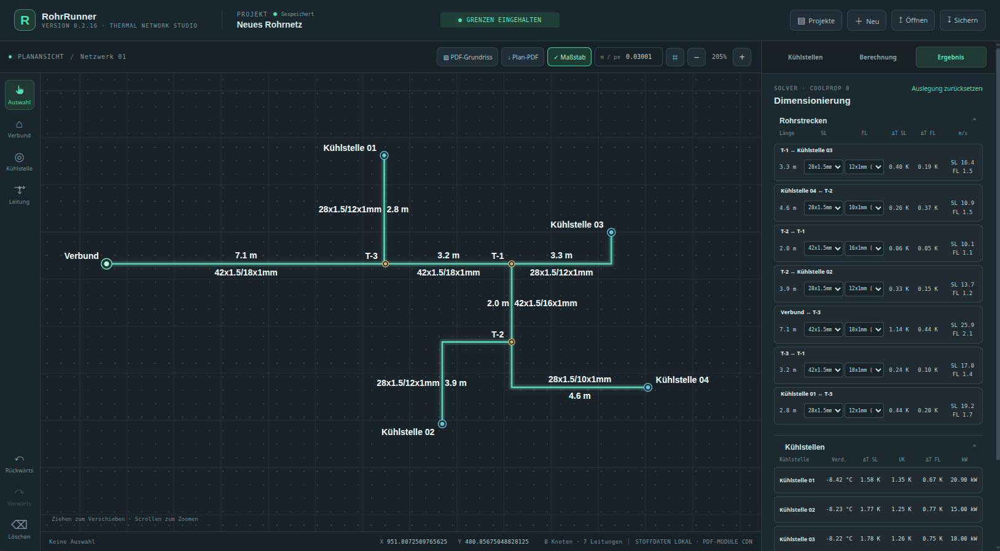
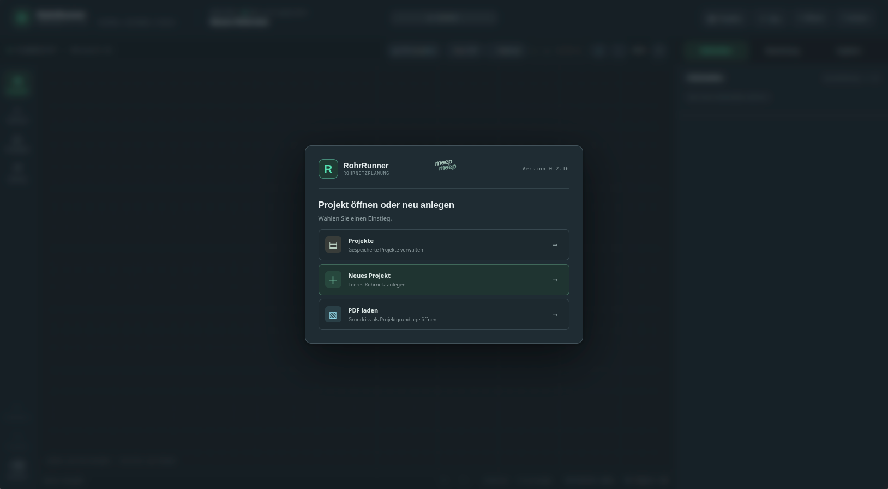

# RohrRunner

**Rohrnetze zeichnen. Betriebspunkte prüfen. Ergebnisse nachvollziehen.**

RohrRunner ist eine lokale Browseranwendung zur grafischen Erfassung und **technischen Vorbemessung von Kältemittelrohrnetzen**. Auf einem PDF-Grundriss oder einer leeren Zeichenfläche entstehen rechtwinklige Leitungsnetze mit Kühlstellen, Lasten und Betriebspunkten. Der integrierte Solver ermittelt Rohrgrößen und zeigt Druckverluste, Geschwindigkeiten und Hinweise direkt am Netz und in der Ergebnisliste.

**Version 0.2.17** · Kein Build-Schritt · Keine npm-Laufzeitpakete · Lokale Projektverwaltung

> [!IMPORTANT]
> RohrRunner ist ein Planungs- und Vorbemessungswerkzeug, **keine technische Freigabe**. Ergebnisse und Anwendungsgrenzen müssen vor der Ausführung durch die verantwortliche Fachplanung geprüft werden. Es werden weder Normerfüllung noch global optimale Rohrgrößen zugesichert.

## Einblicke

Die beiden Ansichten zeigen die Anwendung mit einem beispielhaften Netz bzw. den Projekteinstieg (Screenshots aus Version 0.2.16).

**Netz und Dimensionierung** — Rohrstrecken, berechnete Nennweiten und Kühlstellen im Zusammenhang:



**Projekteinstieg** — vorhandenes Projekt öffnen, ein leeres Netz beginnen oder einen PDF-Grundriss laden:



## In 5 Schritten zum Ergebnis

1. **Starten:** `index.html` direkt im Browser öffnen; unter Windows alternativ `RohrRunner.bat` doppelklicken. Ein Server und Node.js sind für die Nutzung nicht nötig.
2. **Plan vorbereiten:** Optional einen PDF-Grundriss laden (Dateiauswahl oder Drag-and-drop). Den Maßstab mit zwei Punkten und bekannter Entfernung kalibrieren oder `m / px` eintragen. Ohne PDF kann auf der leeren Fläche gearbeitet werden.
3. **Netz zeichnen:** Einen Verbund und Kühlstellen setzen, Lasten in kW eintragen und rechtwinklige Leitungen verbinden. Knoten und Leitungsabschnitte lassen sich anschließend verschieben; Schnitte mit vorhandenen Leitungen erzeugen Abzweige.
4. **Berechnen:** Im Reiter **Berechnung** Kältemittel, Temperaturen und weitere Vorgaben prüfen und **Netz berechnen** wählen. Die Ergebnisse erscheinen im Reiter **Ergebnis**.
5. **Weiterarbeiten:** Rohrgrößen je Abschnitt prüfen oder manuell wählen, Hinweise beachten und Projekt, Ergebnis-CSV oder Plan-PDF exportieren.

Für die optionale Entwicklung über einen lokalen HTTP-Server:

```bash
npm run serve
# anschließend http://127.0.0.1:4173 öffnen
```

`ROHRRUNNER_PORT` kann den Port ändern. Dieser Weg benötigt Node.js, aber keine zusätzlichen npm-Pakete. Über `file://` startet der Berechnungs-Worker aus dem mitgelieferten Bundle; falls der Browser Blob-Worker sperrt, rechnet die App im Hauptthread weiter.

> **PDF-Hinweis:** PDF-Import und Plan-PDF-Export benötigen beim Seitenaufruf eine Internetverbindung für PDF.js und pdf-lib (CDN). Rechenkern, CoolProp und Stoffdaten liegen lokal im Repository. Ohne die PDF-Module bleibt die Arbeit auf der leeren Zeichenfläche möglich.

## Was RohrRunner kann

| Bereich | Möglichkeiten |
| --- | --- |
| **Plan & Editor** | PDF-Seite 1 als Hintergrund, Kalibrierung, orthogonale Leitungen, Abzweige, Zoom und Verschieben, Undo/Redo. |
| **Kühlstellen** | Namen, Kälteleistung, zusätzliche Rohrleitung und Steigleitung erfassen; Projekte mit mehreren Endpunkten bearbeiten. |
| **Leitungsdaten** | Saug- und Flüssigkeitsrohrgrößen, Höhendifferenzen in Fließrichtung, Zusatzlänge und Einzelwiderstände `Σζ` je Abschnitt. |
| **Auslegung** | Automatische Größenwahl oder manuelle Kataloggröße; Betriebspunkt und Grenzwerte für Druckverlust und Geschwindigkeit einstellen. |
| **Ergebnisse** | Rohrstrecken und Kühlstellen gegenüberstellen, Temperaturverluste, Geschwindigkeiten und verbleibende Unterkühlung prüfen; Auffälligkeiten und Grenzverletzungen hervorheben. |
| **Dateien** | Browserlokale Projekte samt PDF automatisch speichern; `.rohrrunner` importieren/exportieren, CSV-Ergebnisse und Plan-PDF herunterladen. |

**Bedienhinweise:** Ein Klick auf einen Leitungsabschnitt öffnet seine Daten im Reiter **Kühlstellen**; ein unsichtbar verbreiterter Klickbereich erleichtert die Auswahl. Eingabefelder in der Kühlstellenliste lassen sich bearbeiten, ohne dadurch die Kühlstelle auszuwählen. Die Ansicht lässt sich auf freier Fläche, mit mittlerer Maustaste oder Leertaste verschieben; Mausrad und Zoom-Schaltflächen ändern den Zoom. Dezimalkomma und Dezimalpunkt werden bei Eingaben akzeptiert.

### Berechnung und Rohrwahl

Die automatische Dimensionierung wählt aus dem hinterlegten Katalog. Manuelle Rohrgrößen lassen sich auch direkt in der Ergebnisliste setzen: Danach erfolgt eine Nachrechnung, bei der die anderen zuletzt berechneten Größen festgehalten werden. **Netz berechnen** startet dagegen erneut die vollständige automatische Auslegung. Warnungen zeigen betroffene Abschnitte oder Kühlstellen an; orange kennzeichnet Prüfbedarf, rot eine Grenzverletzung.

FL fließt vom Verbund zu den Kühlstellen, SL zurück zum Verbund — unabhängig von der Zeichenrichtung. Positive Höhendifferenzen bedeuten einen Anstieg in der jeweiligen Fließrichtung. Nicht eingetragene Höhendifferenzen werden mit 0 m angesetzt.

### Kältemittel und Startwerte

Unterstützt werden **R513A**, **R448A** (metrischer cupromed/cuprofrio-Katalog) und **R744 / CO₂** (Wieland K65 120 bar, **nur unterkritischer Betrieb**). Für R744 muss die Verflüssigungstemperatur unter etwa 30,98 °C liegen.

| Einstellung | Startwert für R513A / R448A |
| --- | ---: |
| Gleichzeitigkeit | 1,00 |
| Verdampfung / Verflüssigung | −10 °C / 45 °C |
| Überhitzung / Unterkühlung | 25 K / 2 K |
| Druckverlust SL / FL max. | 2 K / 1 K |
| Steigleitung min. / Sauggasgeschwindigkeit max. | 7 m/s / 30 m/s |
| Auslegungsdruck | 28 bar Überdruck |
| Rohrrauheit | 1,5 µm |
| Reibungs- / Viskositätszuschlag | 1,5 / 15 % |

Beim Wechsel auf R744 werden 5 °C Verflüssigung und 100 bar Überdruck vorgegeben; beim Wechsel zurück gelten wieder 45 °C und 28 bar. Die übrigen genannten Startwerte bleiben erhalten. Gespeicherte Betriebspunkte werden beim Öffnen nicht überschrieben.

## Projekte und Datenschutz

Projekte werden **im verwendeten Browser** in IndexedDB gespeichert — einschließlich Netz, Einstellungen, Maßstab, letztem Ergebnis und gegebenenfalls PDF. Über **Projekte** können sie geöffnet, umbenannt und gelöscht werden. Eine exportierte `.rohrrunner`-Datei enthält bei geladenem Plan auch dessen PDF als Base64 und eignet sich zur lokalen Übertragung oder Sicherung.

Es gibt keinen Anwendungsserver und keine Cloud-Synchronisierung: Plan und Lasten werden im Browser verarbeitet. Für PDF-Funktionen lädt der Browser jedoch Bibliotheken von Cloudflare bzw. jsDelivr. **Projektdateien und Grundrisse können vertrauliche Daten enthalten.** Vor dem Teilen Inhalt und Metadaten prüfen; `.rohrrunner` und PDFs sind in `.gitignore` ausgeschlossen.

## Fachliche Grenzen

Berechnet werden stationäre, einphasige Saug- und Flüssigkeitsleitungen in einem zusammenhängenden, kreisfreien Netzbaum. Die Flüssigkeitstemperatur bleibt im Modell entlang der Flüssigkeitsleitung konstant. Die automatische Nennweitenwahl ist eine begrenzte Upgrade-Heuristik, **keine globale Kostenoptimierung**.

Nicht abgedeckt sind unter anderem transkritisches CO₂, Druckgasleitungen, Verdichter- und Ventilauslegung, kombinierte Kreise, zeitabhängige Lasten und Teillast-Ölrückführung. Details zu Annahmen, Gleichungen und Gültigkeitsbereichen stehen in der [Berechnungsanleitung](rohrnetz-berechnung-anleitung.md); bekannte Einschränkungen in [BUGS.md](BUGS.md).

## Entwicklung und Mitwirkung

RohrRunner besteht aus statischen Browserdateien ohne Build-Schritt für die Anwendung. Änderungen am Editor und an der Oberfläche liegen in `src/app.js` und `src/style.css`, Geometrie in `src/editor-core.js`, Berechnung in `src/engine.js` und Stoffdaten in `src/stoffdaten.js`. Der lokale Worker nutzt `src/worker.js` bzw. für direkt geöffnete HTML-Dateien `src/worker-bundle.js`.

```bash
npm test                  # Node.js-Tests mit synthetischen Netzen
npm run build:worker      # Worker-Bundle nach Änderungen am Worker aktualisieren
```

Der Testlauf benötigt Node.js, aber keine Installation weiterer Pakete. Er ersetzt keine fachliche Abnahme. Datenquellen für Katalog und Stoffwerte stehen in `data/pipe-catalog.json` und `data/fluid-references.json`; `data/pipe-catalog.js` ist die Browserfassung des Katalogs.

Mehr dazu: [Architektur](ARCHITECTURE.md) · [Mitwirken](CONTRIBUTING.md) · [Änderungsprotokoll](CHANGELOG.md) · [Sicherheitsmeldungen](SECURITY.md).

**Lizenzhinweis:** Für die mitgelieferte CoolProp-Laufzeit liegt eine MIT-Lizenz unter `vendor/coolprop/LICENSE`. Für RohrRunner selbst ist derzeit keine separate Projektlizenz enthalten.
